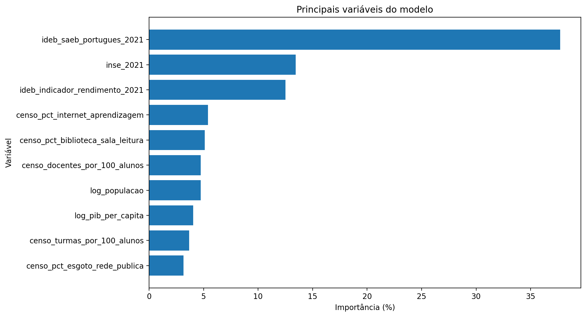
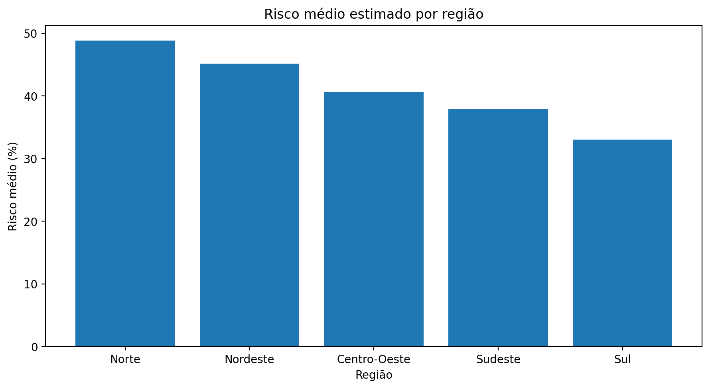
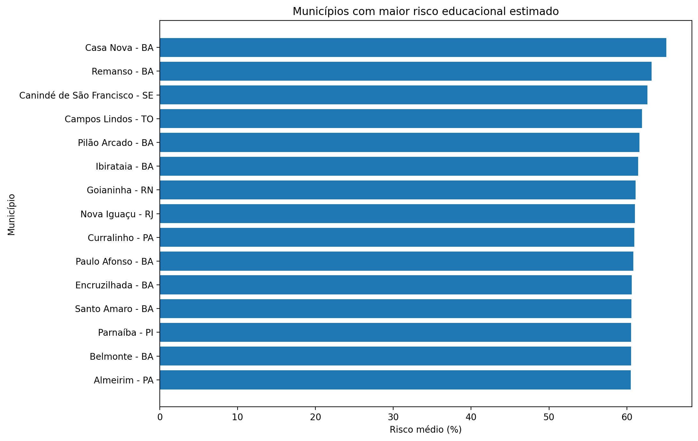
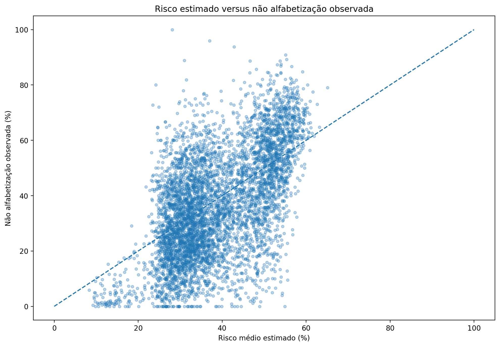
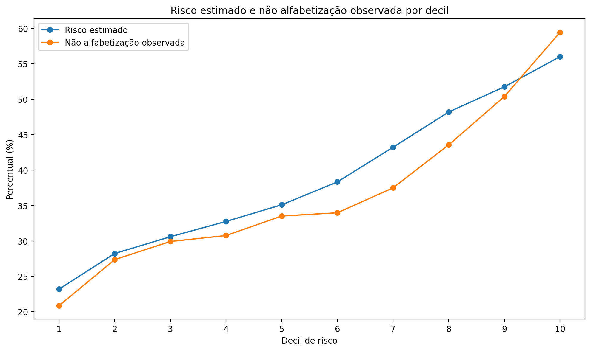
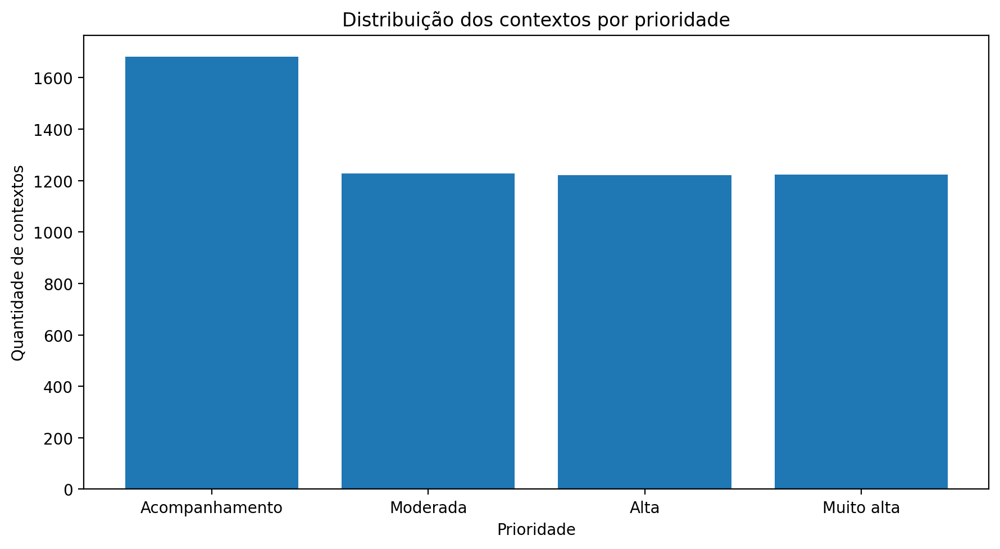
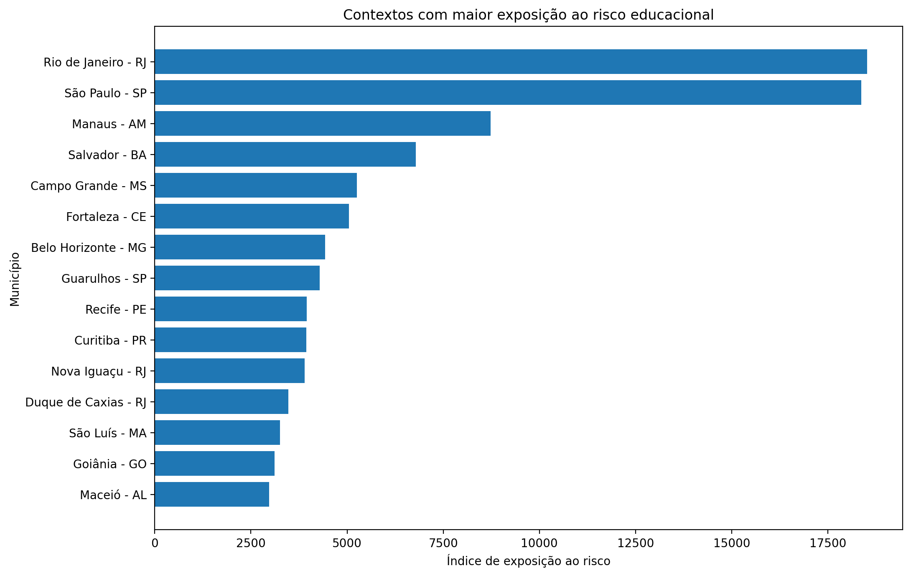

 # Tech Challenge 3 — Predição de Alfabetização e Priorização Educacional

Projeto desenvolvido para a **Fase 3 da Pós-Tech FIAP**, com foco na construção de uma solução completa de Ciência de Dados para análise e predição da alfabetização de estudantes da rede pública brasileira.

O projeto percorre todo o ciclo de Machine Learning: diagnóstico e construção da base analítica, enriquecimento com dados públicos, prevenção de data leakage, modelagem supervisionada, otimização, validação temporal, interpretabilidade e transformação das previsões em indicadores territoriais para apoio à discussão de políticas públicas educacionais.

---

## Sumário

- [1. Contexto](#1-contexto)
- [2. Objetivo](#2-objetivo)
- [3. Principais resultados](#3-principais-resultados)
- [4. Fontes de dados](#4-fontes-de-dados)
- [5. Arquitetura da solução](#5-arquitetura-da-solução)
- [6. Construção da base analítica](#6-construção-da-base-analítica)
- [7. Estratégia de validação e prevenção de leakage](#7-estratégia-de-validação-e-prevenção-de-leakage)
- [8. Modelagem](#8-modelagem)
- [9. Diagnóstico e enriquecimento da V2](#9-diagnóstico-e-enriquecimento-da-v2)
- [10. Otimização e modelo final](#10-otimização-e-modelo-final)
- [11. Interpretabilidade](#11-interpretabilidade)
- [12. Aplicação estratégica](#12-aplicação-estratégica)
- [13. Aderência territorial do modelo](#13-aderência-territorial-do-modelo)
- [14. Aplicação em políticas públicas](#14-aplicação-em-políticas-públicas)
- [15. Limitações](#15-limitações)
- [16. Monitoramento e evoluções futuras](#16-monitoramento-e-evoluções-futuras)
- [17. Estrutura do repositório](#17-estrutura-do-repositório)
- [18. Ordem de execução dos notebooks](#18-ordem-de-execução-dos-notebooks)
- [19. Como reproduzir](#19-como-reproduzir)
- [20. Tecnologias utilizadas](#20-tecnologias-utilizadas)
- [21. Conclusão](#21-conclusão)

---

# 1. Contexto

A alfabetização nos anos iniciais é um dos principais indicadores de qualidade da educação básica.

Além de identificar estudantes alfabetizados e não alfabetizados, o desafio deste projeto foi investigar de que forma informações educacionais, socioeconômicas, demográficas e de infraestrutura podem contribuir para a identificação de contextos com maior vulnerabilidade educacional.

A solução foi construída considerando que um modelo de Machine Learning aplicado a políticas públicas não deve ser avaliado apenas pela métrica preditiva.

O objetivo final é transformar os resultados da modelagem em **inteligência aplicada**, permitindo identificar padrões, territórios prioritários e fatores associados ao risco educacional.

---

# 2. Objetivo

Construir um modelo supervisionado capaz de estimar o risco de um estudante da rede pública não estar alfabetizado e utilizar esse sinal para produzir análises territoriais de apoio à tomada de decisão.

O projeto busca responder perguntas como:

- Quais fatores apresentam maior influência nas previsões do modelo?
- Quais municípios apresentam maior risco educacional?
- Existem padrões regionais relevantes?
- Quais regiões apresentam perfis semelhantes?
- Quais contextos apresentam maior distância em relação às metas de alfabetização?
- Como combinar vulnerabilidade e escala da população estudantil para apoiar priorizações?

A variável target é individual:

```text
1 = alfabetizado
0 = não alfabetizado
```

---

# 3. Principais resultados

O modelo final selecionado foi uma **Random Forest**, treinada com dados de 2023 e avaliada em uma base temporalmente isolada de 2024.

### Desempenho final em 2024

| Métrica | Resultado |
|---|---:|
| ROC-AUC | **0,6221** |
| Accuracy | 0,6123 |
| Precision — não alfabetizado | 0,5240 |
| Recall — não alfabetizado | 0,3934 |
| F1 — não alfabetizado | 0,4494 |
| Precision — alfabetizado | 0,6505 |
| Recall — alfabetizado | 0,7596 |
| F1 — alfabetizado | 0,7008 |

A ROC-AUC obtida na validação foi aproximadamente **0,6164**, enquanto o teste temporal de 2024 apresentou **0,6221**, indicando estabilidade do modelo fora da amostra utilizada para desenvolvimento.

A capacidade discriminatória individual é moderada. Entretanto, as análises agregadas mostraram que o score produzido pelo modelo apresenta utilidade para **ordenar municípios segundo diferentes níveis de vulnerabilidade educacional**.

---

# 4. Fontes de dados

Foram utilizadas bases educacionais, socioeconômicas e demográficas de diferentes fontes públicas.

Entre as principais informações incorporadas estão:

### Avaliação da Alfabetização

Base utilizada para construção do target individual de alfabetização.

Foram considerados apenas estudantes com participação válida na avaliação e pertencentes às redes públicas analisadas.

### INSE — Indicador de Nível Socioeconômico

Foi utilizada a edição de 2021, agregada ao nível compatível com a base de modelagem.

Feature principal:

```text
inse_2021
```

### Censo Escolar

Indicadores municipais e de rede relacionados à infraestrutura e aos recursos educacionais:

```text
censo_pct_agua_potavel
censo_pct_energia_rede_publica
censo_pct_esgoto_rede_publica
censo_pct_biblioteca_sala_leitura
censo_pct_laboratorio_informatica
censo_pct_internet_aprendizagem
censo_docentes_por_100_alunos
censo_turmas_por_100_alunos
```

### IBGE

Informações econômicas e demográficas:

```text
PIB municipal
população
PIB per capita
log_populacao
log_pib_per_capita
```

### IDEB / SAEB

Após diagnóstico da primeira versão do modelo, foram incorporados indicadores históricos de desempenho educacional de 2021:

```text
ideb_saeb_portugues_2021
ideb_indicador_rendimento_2021
```

A escolha de 2021 permite utilizar informação histórica anterior aos targets de 2023 e 2024, evitando leakage temporal.

### Metas de alfabetização

As metas educacionais foram utilizadas posteriormente na etapa estratégica para comparar o sinal atual de risco com objetivos futuros estabelecidos para os territórios.

---

# 5. Arquitetura da solução

A solução foi organizada de forma incremental.

```text
Dados educacionais
        +
Dados socioeconômicos
        +
Dados demográficos
        +
Dados de infraestrutura
        +
Indicadores históricos
        │
        ▼
Construção da base analítica
        │
        ▼
Tratamento e validação
        │
        ▼
Split temporal e territorial
        │
        ▼
Modelos baseline
        │
        ▼
Diagnóstico do sinal
        │
        ▼
Enriquecimento V2
        │
        ▼
Otimização
        │
        ▼
Random Forest final
        │
        ▼
Teste temporal 2024
        │
        ▼
Interpretabilidade
        │
        ▼
Predições territoriais
        │
        ▼
Risco + metas + priorização
        │
        ▼
Inteligência aplicada
```

Os produtos analíticos finais são persistidos na camada **Gold**, permitindo seu consumo por notebooks posteriores sem necessidade de retreinamento do modelo.

---

# 6. Construção da base analítica

A população válida foi construída a partir da base de alunos considerando:

- presença válida na avaliação;
- avaliação preenchida;
- redes públicas selecionadas;
- target individual disponível.

A base final de modelagem contém aproximadamente:

```text
2023: 1,50 milhão de alunos
2024: 1,85 milhão de alunos

Total: aproximadamente 3,35 milhões de registros
```

As features utilizadas são majoritariamente contextuais, representando características do município e da rede de ensino do estudante.

A versão inicial da base foi persistida em:

```text
workspace.gold.ml_alfabetizacao_aluno
```

Após o enriquecimento com indicadores históricos do IDEB, foi construída a V2:

```text
workspace.gold.ml_alfabetizacao_aluno_v2
```

---

# 7. Estratégia de validação e prevenção de leakage

Um dos pontos centrais do projeto foi evitar contaminação entre treino, validação e teste.

Como grande parte das features está em nível municipal, uma divisão completamente aleatória por aluno poderia colocar estudantes do mesmo município simultaneamente em treino e validação.

Isso aumentaria artificialmente a capacidade aparente de generalização.

Por esse motivo, foi utilizada uma estratégia híbrida.

### Teste

Todo o ano de **2024** foi reservado como teste temporal final.

```text
Teste 2024:
~1,85 milhão de alunos
5.517 municípios
```

Essa base não foi utilizada para seleção de modelo, hiperparâmetros ou threshold.

### Treino e validação

Os dados de 2023 foram divididos por município.

Cada município aparece apenas em um dos conjuntos.

```text
Treino:
~1,19 milhão de alunos
3.897 municípios

Validação:
~317 mil alunos
974 municípios
```

Dessa forma, o processo avalia simultaneamente:

- generalização para municípios não vistos durante o treinamento;
- generalização temporal para um novo ano.

O split foi persistido em:

```text
workspace.gold.ml_split_modelagem
```

---

# 8. Modelagem

A primeira etapa comparou diferentes algoritmos supervisionados.

Foram avaliados:

- Regressão Logística;
- Decision Tree;
- Random Forest.

### Resultados iniciais

| Modelo | ROC-AUC aproximada |
|---|---:|
| Regressão Logística | 0,569 |
| Decision Tree | 0,536 |
| Random Forest | 0,577 |

Os resultados mostraram que a base inicial continha algum sinal preditivo, mas ainda insuficiente para uma boa diferenciação individual.

Em vez de apenas aumentar a complexidade dos algoritmos, foi realizado um diagnóstico das próprias features.

---

# 9. Diagnóstico e enriquecimento da V2

O diagnóstico mostrou uma característica fundamental do problema:

aproximadamente **98,6% dos contextos município/rede apresentavam simultaneamente estudantes alfabetizados e não alfabetizados**.

Isso significa que features exclusivamente contextuais possuem um limite natural para prever diferenças individuais entre estudantes pertencentes ao mesmo território.

Também foram avaliadas variáveis individualmente.

Entre os melhores sinais estavam:

```text
docentes por 100 alunos
INSE
```

Ainda assim, o poder discriminatório isolado permanecia baixo.

A partir desse diagnóstico foi incorporado desempenho educacional histórico anterior ao período de modelagem.

As principais novas features foram:

```text
ideb_saeb_portugues_2021
ideb_indicador_rendimento_2021
```

### Resultado da V2

| Modelo | ROC-AUC de validação |
|---|---:|
| Regressão Logística | ~0,606 |
| Decision Tree | ~0,569 |
| Random Forest | **~0,613** |

A Random Forest apresentou ganho de aproximadamente **0,036 ponto de AUC** em relação à primeira versão.

O enriquecimento das features teve impacto maior do que simplesmente aumentar a complexidade do algoritmo.

---

# 10. Otimização e modelo final

Após a definição da base V2, foram avaliadas diferentes configurações de:

- Regressão Logística;
- Random Forest;
- Gradient-Boosted Trees.

A melhor Random Forest de validação apresentou aproximadamente:

```text
ROC-AUC validação: 0,6164
ROC-AUC treino:    0,6695
Gap:               0,0531
```

Configuração selecionada:

```text
numTrees = 100
maxDepth = 10
minInstancesPerNode = 30
subsamplingRate = 1.0
seed = 42
```

Também foram avaliados diferentes thresholds para a classe de não alfabetização.

| Threshold | Accuracy | Recall classe 0 | F1 classe 0 |
|---|---:|---:|---:|
| 0,50 | 0,601 | 0,304 | 0,389 |
| **0,55** | **0,597** | **0,467** | **0,492** |
| 0,60 | 0,575 | 0,659 | 0,564 |
| 0,65 | 0,544 | 0,787 | 0,591 |

O threshold de **0,55** foi selecionado como compromisso entre capacidade de identificação dos estudantes em maior risco e desempenho global.

Após todas as decisões de desenvolvimento, a Random Forest foi treinada novamente utilizando todo o conjunto de 2023 e avaliada uma única vez no teste temporal de 2024.

---

# 11. Interpretabilidade

A análise de feature importance mostrou que o modelo depende principalmente de indicadores históricos de desempenho educacional e contexto socioeconômico.



Principais variáveis:

| Feature | Importância |
|---|---:|
| SAEB Português 2021 | 37,72% |
| INSE 2021 | 13,45% |
| Indicador de rendimento 2021 | 12,52% |
| Internet para aprendizagem | 5,41% |
| Biblioteca / sala de leitura | 5,11% |
| Docentes por 100 alunos | 4,75% |
| Log da população | 4,74% |
| Log do PIB per capita | 4,06% |
| Turmas por 100 alunos | 3,67% |
| Rede de esgoto | 3,17% |

As três primeiras variáveis concentram aproximadamente **63,7% da importância total**.

Esses resultados sugerem forte associação entre:

- desempenho educacional histórico;
- nível socioeconômico;
- rendimento escolar;

e o risco previsto pelo modelo.

As importâncias representam relações utilizadas pela Random Forest para realizar suas previsões e **não devem ser interpretadas como relações causais**.

---

# 12. Aplicação estratégica

As probabilidades produzidas pelo modelo foram transformadas em indicadores territoriais.

Para cada município foi calculado o risco médio:

```text
risco_medio_pct
=
média da probabilidade estimada de pertencer à classe
"não alfabetizado"
```

Esse indicador deve ser interpretado como um **score relativo de vulnerabilidade**.

Ele não representa necessariamente a taxa futura exata de estudantes não alfabetizados, pois as probabilidades não passaram por processo formal de calibração para esse objetivo.

## Risco por região



A análise regional apresentou a seguinte ordenação de risco médio:

```text
Norte
Nordeste
Centro-Oeste
Sudeste
Sul
```

Apesar dessa tendência agregada, existem diferenças importantes dentro de cada região.

O Ceará, por exemplo, apresentou comportamento significativamente melhor que grande parte dos estados do Nordeste, mostrando a importância de evitar conclusões baseadas exclusivamente em agrupamentos regionais.

## Municípios com maior risco



Entre os municípios com maiores scores de risco apareceram contextos como:

```text
Casa Nova - BA
Remanso - BA
Canindé de São Francisco - SE
Campos Lindos - TO
Pilão Arcado - BA
Ibirataia - BA
Goianinha - RN
Nova Iguaçu - RJ
Curralinho - PA
```

A análise das faixas de risco apresentou comportamento coerente.

Municípios classificados nas faixas mais elevadas tendem a apresentar:

- menor INSE;
- menor desempenho histórico no SAEB;
- menor indicador de rendimento;
- menor disponibilidade de internet educacional;
- menor presença de biblioteca;
- menor quantidade de docentes por aluno.

---

# 13. Aderência territorial do modelo

Além das métricas individuais, foi investigado se o score produzido pelo modelo consegue identificar diferenças reais entre municípios.

Foi comparado:

```text
risco médio estimado pelo modelo
versus
taxa observada de não alfabetização em 2024
```



A análise apresenta dispersão relevante, reforçando que o risco estimado não deve ser interpretado como uma taxa perfeitamente calibrada.

Entretanto, existe associação positiva entre o sinal do modelo e a não alfabetização observada.

Para avaliar melhor a capacidade de ordenação, os municípios foram divididos em dez decis segundo o risco estimado.



A análise por decis evidencia que, conforme aumenta o risco estimado pelo modelo, também aumenta, em média, a taxa efetivamente observada de não alfabetização.

Esse resultado é particularmente importante para a aplicação proposta.

Mesmo com desempenho individual moderado, o modelo apresenta capacidade de **ordenar contextos territoriais segundo diferentes níveis de vulnerabilidade educacional**.

---

# 14. Comparação com metas e priorização

As previsões de 2024 foram integradas às metas oficiais de alfabetização.

É importante destacar que o modelo **não está prevendo diretamente a taxa de alfabetização de 2025**.

A comparação utiliza o score atual como indicador de situação educacional e calcula sua distância em relação à próxima meta disponível.

Foi definida:

```text
defasagem_meta_pp
=
meta futura - score de alfabetização atual
```

Apenas valores positivos representam contextos abaixo da meta.

A priorização foi construída a partir da distribuição dessas defasagens.

Categorias:

```text
Muito alta
Alta
Moderada
Acompanhamento
```



Resultados médios:

| Prioridade | Contextos | Defasagem média |
|---|---:|---:|
| Muito alta | 1.223 | 17,04 p.p. |
| Alta | 1.220 | 8,01 p.p. |
| Moderada | 1.228 | 2,89 p.p. |
| Acompanhamento | 1.681 | 0 p.p. |

Além da vulnerabilidade, foi construído um indicador complementar de escala:

```text
indice_exposicao_risco
=
quantidade de alunos × risco médio
```

Esse indicador não representa uma estimativa literal da quantidade de estudantes não alfabetizados.

Sua função é combinar:

- tamanho da população estudantil;
- intensidade média do risco.



Isso permite duas leituras complementares:

### Vulnerabilidade

Quais territórios apresentam maior distância em relação às metas?

### Escala

Em quais territórios o risco está associado a uma população estudantil maior?

Grandes municípios podem não apresentar o maior risco percentual, mas ainda assim concentrar alta exposição devido ao número elevado de estudantes.

---

# 15. Aplicação em políticas públicas

Os resultados podem apoiar gestores na definição de prioridades para análises e intervenções educacionais.

Entre as possibilidades de aplicação estão:

- identificação de municípios com maior vulnerabilidade;
- seleção de territórios para diagnóstico pedagógico aprofundado;
- acompanhamento de contextos mais distantes das metas;
- identificação de regiões com perfis semelhantes;
- investigação de infraestrutura e condições socioeconômicas;
- direcionamento de programas de apoio;
- monitoramento da evolução dos indicadores educacionais.

O modelo não deve ser utilizado como mecanismo automático para distribuição de recursos ou tomada de decisões individuais.

Sua finalidade é atuar como **instrumento complementar de inteligência analítica**, auxiliando gestores a identificar onde investigações e ações adicionais podem ser necessárias.

---

# 16. Limitações

## Granularidade das features

A principal limitação está relacionada à granularidade dos dados disponíveis.

O target é individual, porém grande parte das features representa características do município ou da rede.

Assim, estudantes pertencentes ao mesmo contexto compartilham grande parte das informações utilizadas pelo modelo.

Isso limita naturalmente a capacidade de diferenciação entre indivíduos.

## Identificadores entre bases

Foi investigada a incorporação de informações adicionais em nível de aluno ou escola.

Entretanto, identificadores mascarados ou incompatíveis entre diferentes edições das bases públicas impediram alguns relacionamentos confiáveis.

Por esse motivo, esses cruzamentos não foram utilizados.

## Capacidade discriminatória

A ROC-AUC final de **0,6221** representa capacidade discriminatória moderada.

As probabilidades são utilizadas principalmente como **scores de risco**, e não como taxas perfeitamente calibradas de alfabetização.

## Interpretabilidade

Feature importance mostra quanto cada variável participa das decisões do modelo.

Ela não demonstra causalidade.

Por exemplo, uma variável associada a maior risco não necessariamente representa uma causa direta da não alfabetização.

## Metas futuras

A distância em relação às metas não representa uma previsão direta do resultado futuro.

Ela compara o sinal atual produzido pelo modelo com uma meta estabelecida para um período posterior.

---

# 17. Monitoramento e evoluções futuras

Em um cenário produtivo, o modelo deverá ser acompanhado ao longo do tempo.

Entre os principais indicadores de monitoramento estão:

- ROC-AUC;
- precision;
- recall;
- F1-score;
- distribuição das probabilidades;
- distribuição das principais features;
- cobertura das fontes;
- relação entre risco estimado e resultados observados;
- estabilidade das feature importances;
- desempenho por região;
- desempenho por rede;
- evolução da distância em relação às metas.

Novas edições da avaliação poderão ser utilizadas como novos testes temporais.

Posteriormente, também poderão alimentar ciclos de retreinamento.

## Possíveis evoluções

- incorporação de features em nível de escola;
- incorporação de características individuais adicionais;
- novas fontes educacionais;
- calibração probabilística;
- análise de drift;
- SHAP Values;
- novos algoritmos de boosting;
- modelos específicos por contexto educacional;
- avaliação de fairness entre grupos e territórios;
- criação de dashboards de monitoramento.

---

# 18. Produtos analíticos persistidos

O projeto gera produtos reutilizáveis na camada Gold.

```text
workspace.gold.ml_alfabetizacao_aluno
workspace.gold.ml_alfabetizacao_aluno_v2
workspace.gold.ml_split_modelagem
workspace.gold.ml_predicoes_2024
workspace.gold.ml_feature_importance
workspace.gold.ml_risco_municipio_2024
workspace.gold.ml_risco_uf_2024
workspace.gold.ml_risco_regiao_2024
workspace.gold.ml_priorizacao_educacional_2024
```

As tabelas finais permitem reutilizar os resultados sem necessidade de executar novamente todo o processo de treinamento.

---

# 19. Estrutura do repositório

```text
fiap_tech_challenge_3/
│
├── notebooks/
│   ├── 01_diagnostico_base_modelagem.ipynb
│   ├── 02_selecao_fontes_enriquecimento.ipynb
│   ├── 03_construcao_base_analitica.ipynb
│   ├── 04_preprocessamento_split_modelagem.ipynb
│   ├── 05_modelagem_baseline.ipynb
│   ├── 06_diagnostico_modelagem.ipynb
│   ├── 07_enriquecimento_v2.ipynb
│   ├── 08_modelagem_v2.ipynb
│   ├── 09_otimizacao_modelo.ipynb
│   ├── 10_avaliacao_final_interpretabilidade.ipynb
│   └── 11_aplicacao_estrategica.ipynb
│
├── images/
│   ├── feature_importance.png
│   ├── risco_por_regiao.png
│   ├── municipios_maior_risco.png
│   ├── exposicao_risco.png
│   ├── distribuicao_prioridade.png
│   ├── aderencia_modelo_municipios.png
│   └── aderencia_por_decil.png
│
├── reports/
│   └── tables/
│       ├── feature_importance.csv
│       ├── risco_por_regiao.csv
│       ├── top_municipios_risco.csv
│       ├── top_exposicao_risco.csv
│       ├── priorizacao_educacional_2024.csv
│       ├── aderencia_municipal.csv
│       └── aderencia_por_decil.csv
│
├── requirements.txt
├── README.md
└── .gitignore
```

---

# 20. Ordem de execução dos notebooks

Os notebooks foram construídos de maneira incremental e devem ser executados na seguinte ordem:

| Notebook | Objetivo |
|---|---|
| `01_diagnostico_base_modelagem` | Diagnóstico da população e definição do target |
| `02_selecao_fontes_enriquecimento` | Seleção e avaliação das fontes externas |
| `03_construcao_base_analitica` | Construção da primeira base de modelagem |
| `04_preprocessamento_split_modelagem` | Preparação dos dados e split sem leakage |
| `05_modelagem_baseline` | Comparação dos primeiros algoritmos |
| `06_diagnostico_modelagem` | Investigação das limitações da primeira versão |
| `07_enriquecimento_v2` | Inclusão de indicadores históricos do IDEB |
| `08_modelagem_v2` | Reavaliação dos algoritmos com a base enriquecida |
| `09_otimizacao_modelo` | Tuning, análise de overfitting e threshold |
| `10_avaliacao_final_interpretabilidade` | Treino definitivo, teste temporal e feature importance |
| `11_aplicacao_estrategica` | Análises territoriais, metas e priorização |

Essa organização mantém separadas as etapas de:

```text
exploração
→ preparação
→ desenvolvimento
→ avaliação
→ aplicação
```

---

# 21. Como reproduzir

## Pré-requisitos

O projeto foi desenvolvido principalmente em ambiente **Databricks**, utilizando Apache Spark.

Principais dependências:

```text
Python
PySpark
Spark ML
Pandas
NumPy
Matplotlib
Google BigQuery Connector
```

As dependências adicionais estão documentadas em:

```text
requirements.txt
```

## Credenciais

As credenciais de acesso ao Google Cloud não são armazenadas no repositório.

No Databricks, o projeto utiliza Secret Scope:

```python
credencial_gcp = dbutils.secrets.get(
    scope="fiap-tech-challenge",
    key="gcp-service-account-b64"
)
```

O projeto de billing é parametrizado através de widget:

```python
dbutils.widgets.text(
    "billing_project_id",
    "fiap-tech-challenge2",
    "Billing Project GCP"
)

billing_project_id = dbutils.widgets.get(
    "billing_project_id"
)
```

Dessa forma, informações sensíveis permanecem fora do código versionado.

## Execução

1. Configurar o ambiente Databricks.
2. Configurar o Secret Scope utilizado para autenticação no Google Cloud.
3. Configurar o `billing_project_id`.
4. Executar os notebooks na ordem apresentada neste README.
5. Validar a criação das tabelas intermediárias e Gold.
6. Executar o notebook de avaliação final.
7. Executar o notebook de aplicação estratégica.

Os produtos finais estarão disponíveis tanto na camada Gold quanto nas pastas:

```text
images/
reports/tables/
```

---

# 22. Tecnologias utilizadas

### Processamento

- Apache Spark
- PySpark
- Spark SQL

### Machine Learning

- Spark ML
- Logistic Regression
- Decision Tree
- Random Forest
- Gradient-Boosted Trees

### Análise de dados

- Pandas
- NumPy

### Visualização

- Matplotlib

### Plataforma

- Databricks
- Unity Catalog

### Dados externos

- Google BigQuery
- Base dos Dados
- bases públicas educacionais e socioeconômicas

### Versionamento

- Git
- GitHub
- desenvolvimento baseado em branches e Pull Requests

---

# 23. Principais aprendizados

Um dos principais resultados deste projeto foi mostrar que melhoria de performance não depende apenas da escolha de algoritmos mais complexos.

A primeira versão da Random Forest apresentou ROC-AUC próxima de **0,577**.

Após investigar as limitações das features e incorporar informações históricas relevantes, o modelo passou a aproximadamente **0,613–0,616** na validação, chegando a **0,6221** no teste temporal final.

Esse processo reforça a importância de:

- compreender a granularidade dos dados;
- investigar leakage;
- analisar a origem do sinal preditivo;
- validar temporalmente;
- evitar otimização baseada apenas na métrica;
- transformar previsões em produtos úteis para o problema de negócio.

O projeto também mostra que um modelo com desempenho individual moderado ainda pode produzir valor quando utilizado de forma adequada.

Neste caso, a capacidade de ordenação territorial permitiu construir indicadores úteis para identificação de contextos com maior vulnerabilidade educacional.

---

# 24. Conclusão

O projeto desenvolveu uma pipeline completa de Ciência de Dados para análise da alfabetização na educação pública brasileira.

A solução integrou milhões de registros individuais a informações educacionais, socioeconômicas, demográficas e de infraestrutura.

A estratégia de validação foi construída para reduzir riscos de leakage territorial e temporal.

Após uma primeira modelagem, o diagnóstico das limitações das features levou à construção de uma segunda versão enriquecida, melhorando de forma consistente o desempenho dos modelos.

A Random Forest foi selecionada como modelo final após comparação de algoritmos, otimização de hiperparâmetros e avaliação de overfitting.

No teste temporal de 2024, o modelo alcançou:

```text
ROC-AUC = 0,6221
```

Embora a capacidade individual seja moderada, as análises territoriais mostraram que o score produzido pelo modelo consegue diferenciar contextos de menor e maior vulnerabilidade.

A partir desse sinal foram construídos:

- indicadores municipais;
- análises por UF e região;
- grupos de risco;
- comparação com metas educacionais;
- indicadores de defasagem;
- priorização por vulnerabilidade;
- indicadores de exposição ao risco.

Com isso, o projeto completa o ciclo entre:

```text
dados
→ engenharia de features
→ Machine Learning
→ validação
→ interpretabilidade
→ inteligência aplicada
```

O objetivo não é substituir a decisão de gestores públicos, mas fornecer evidências adicionais para apoiar a identificação de territórios que merecem investigação e acompanhamento prioritário.

---